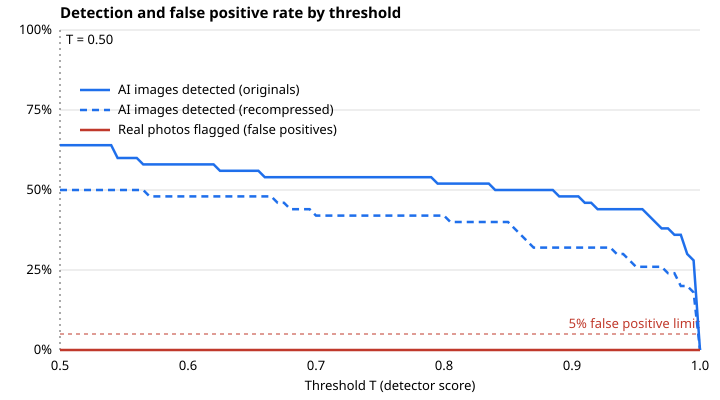

# Detector evaluation results

Generated by `extension/eval/analyze.mjs` from `results.csv`. Do not edit by hand.

## Set

- 228 images scored through the extension's own pipeline (114 originals and 114 recompressed copies: 60% size, JPEG quality 50).
- AI: 50 originals from 7 generators (Midjourney, DALL-E, Stable Diffusion, Flux, Imagen, Leonardo AI, Meta AI). Real: 64 photographs (Wikimedia Commons Quality images).
- 0 image(s) were decided by provenance or metadata before the detector ran and are left out of the rates below.

## Rates by threshold

| Threshold T | False positives (real photos) | Detection (AI, all) | Detection (AI originals) | Detection (AI recompressed) |
| --- | --- | --- | --- | --- |
| 0.50 **(chosen)** | 0.0% | 63.0% | 76.0% | 50.0% |
| 0.60 | 0.0% | 60.0% | 72.0% | 48.0% |
| 0.70 | 0.0% | 56.0% | 70.0% | 42.0% |
| 0.80 | 0.0% | 56.0% | 70.0% | 42.0% |
| 0.90 | 0.0% | 50.0% | 68.0% | 32.0% |
| 0.95 | 0.0% | 47.0% | 68.0% | 26.0% |
| 0.99 | 0.0% | 42.0% | 64.0% | 20.0% |

## Chosen threshold: T = 0.50

The lowest threshold with a real-photo false positive rate of at most 5% (REQ-NF-006). At T = 0.50: false positive rate 0.0% (0 of 128), detection rate 63.0% (63 of 100).

## Detection by generator at the chosen threshold

| Generator | Originals | Recompressed |
| --- | --- | --- |
| Midjourney | 46.2% (13) | 7.7% (13) |
| DALL-E | 92.3% (13) | 76.9% (13) |
| Stable Diffusion | 83.3% (12) | 66.7% (12) |
| Flux | 100.0% (1) | 100.0% (1) |
| Imagen | 100.0% (2) | 50.0% (2) |
| Leonardo AI | 100.0% (5) | 60.0% (5) |
| Meta AI | 50.0% (4) | 25.0% (4) |

## Real photos flagged at the chosen threshold

None.

## Limits of this evaluation

- The set is small and comes from one source. Rates have wide margins: with 120 real images, one image is 0.8 percentage points.
- Two entries were removed after a manual look (a screenshot of a user interface and an AI-enhanced real photo); they stay in `manifest.json` marked `excluded`. The rest of the labels were not individually verified.
- Commons categories are user-assigned, so a few labels may be wrong, and many images predate the detector and could have been in its training data. Expect lower detection on new generators.
- Only one kind of degradation (downscale plus JPEG recompression) was tested; screenshots, crops and filters were not.

